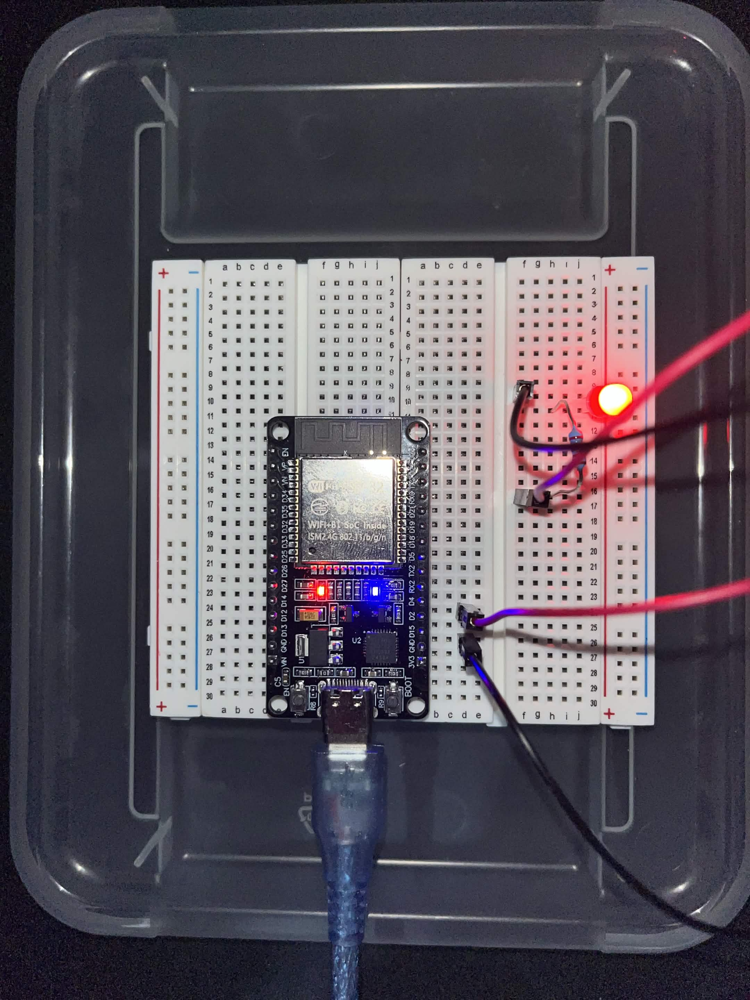
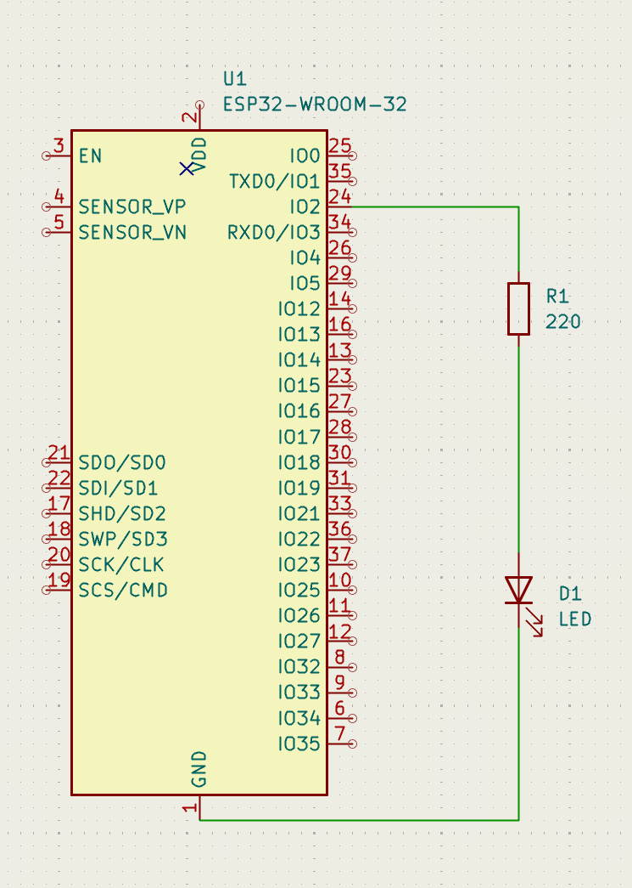

# MEP-1-led

MEP-1-led est le premier projet de la suite de projets MEP. Dans ce projet, il y a un exercice dans lequel je fais clignoter une LED. La partie mandatory consiste à la faire clignoter à un intervalle régulier de 500 ms, tandis que la partie bonus consiste à écrire SOS en morse.

## Montage




## Calcule de R1

J'ai utilisé la loi d'Ohm pour déterminer R1.
```
R = U / I
R = (V_alim - V_LED) / I_LED

V_alim : la tension de la source, de 3,3 V pour une GPIO d'ESP32
V_LED : la tension de seuil de la LED, 2 V pour du rouge
I_LED : le courant voulu, en ampères, ici 6 mA

R = (3,3 - 2) / 0,006 ≈ 218 Ω
```

La puissance dissipée se mesure en watts :
```
P = U x I, ou avec la loi d'Ohm, P = R x I²
220 × 0,006² ≈ 0,008 W
```

## Pourquoi app_main et pas main ?

Parce que `app_main()` est une fonction appelée par ESP-IDF, dans une tâche FreeRTOS, appelée _main task_, et c'est cette tâche qui appelle la fonction `app_main()`.

## Pourquoi vTaskDelay et pas une boucle de comptage ?

Le programme deviendrait une attente active, et donc le CPU tournerait à vide en comptant au lieu de se reposer. Les autres tâches sont bloquées parce que la boucle monopolise le CPU. De plus, ça consomme plus d'énergie.
